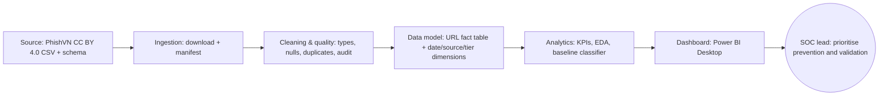

# Phishing Threat Intelligence Dashboard: Prioritising URL-Based Threats

## 1. Dataset selection and dataset card

This project uses **PhishVN Version 4 (v3.1.0 open archive)**, a documented Vietnamese-context dataset of phishing and legitimate URLs. Its main CSV contains 53,116 records and 29 columns, one row per URL. The gold/silver core has 18,997 records; a labelled bronze expansion adds 34,119 community/feed-sourced phishing records (Nguyen Vu, 2026). It supports the course lifecycle from ingestion through classification and evaluation.

| Dataset-card field | Details |
|---|---|
| Name | PhishVN: A Time-Stamped Vietnamese URL Phishing Dataset with Impersonation-Scenario Labels and Confidence Tiers |
| Publisher / URL | Thai Nguyen Vu, Mendeley Data: https://data.mendeley.com/datasets/b97hxbxtpd/4 |
| Exact licence | Creative Commons Attribution 4.0 International (CC BY 4.0): https://creativecommons.org/licenses/by/4.0/ |
| Version / access date | Version 4, published 18 August 2026; consulted 18 October 2026 |
| Grain | One row per URL record |
| Period | In the downloaded CSV, 21,661 `collected_at` values were parseable (40.8% of rows), ranging from 2020-02-08 to 2026-03-25 across all classes. For phishing records, the publisher documents source-attested dates from 2020-02-08 to 2025-02-18; later dates in the combined CSV include benign-organisation certification records, not phishing detections. The field is therefore not a complete time series for every row, and analysis must distinguish event dates from benign certification dates. |
| Size | Main table: 53,116 rows × 29 columns. Downloaded CSV: 11,263,539 bytes (10.74 MiB), measured locally on 18 October 2026. |
| Key columns | Date: `collected_at`, `scraped_at`; categorical: `label`, `source`, `tier`, `scenario`, `lang`, `status`, `split`, `tld`; numeric: `url_len`, `num_dots`, `num_subdomains`, `rank`; candidate target: `label` (`phishing` / `benign`). |
| Known quality issues | Local first-pass profile found 31,455 missing `collected_at` values (59.2%); `text`, `msg_len`, `gen_model` and `has_url` are empty in all 53,116 rows; `impersonated_org` is missing in 96.2%, `status` in 95.1%, and `rank` in 84.0%. Exact duplicate URL occurrences: 0. Conservative normalisation flagged 2 repeated occurrences across two pairs of benign/gold records; both pairs contain user-info-like text before `@`, so they must be reviewed rather than automatically removed. Published label-audit estimates indicate 12.1% positive-arm label noise (95% CI 7.1–20.0%), concentrated in bronze, and 4.0% in the benign arm. The released main CSV does not contain an `is_https` column; the dataset documentation notes that `is_https` in the CompPhish-aligned feature representation is a collection artefact and should be excluded if that representation is used. |
| Additional source to join | A dated Tranco top-sites ranking snapshot (https://tranco-list.eu/) is planned as a second-source enrichment, joined to the registrable domain and list ID to add a reproducible popularity-rank feature. Tranco is already represented among the benign-source strata, so the join must be treated as a time-stamped enrichment rather than independent proof of legitimacy; missing matches are not evidence of maliciousness (Le Pochat et al., 2019). NIST Phish Scale guidance is used separately as a governance/training framework, not as a row-level join (Dawkins and Jacobs, 2023). |

**Eligibility decision.** The dataset has an explicit licence, schema, more than 5,000 rows, categorical dimensions, numeric measures and a classification target. The published source documentation reports phishing dates from 8 February 2020 to 18 February 2025; in the local CSV, date values use day/month/year formatting and must be parsed accordingly. The local profile confirms 53,116 rows and 29 columns, 36,706 phishing labels and 16,410 benign labels. There are 31,455 missing `collected_at` values (59.2%); 21,661 values parse after accounting for the source’s day/month/year format, ranging from 8 February 2020 to 25 March 2026 across all classes. The phishing-only source-attested range documented by the publisher ends on 18 February 2025; later dates in this local range include benign registry/certification records. Four fields (`text`, `msg_len`, `gen_model`, `has_url`) are entirely empty in this CSV. The Vietnamese context limits generalisation to Spain; these limitations must be visible in the analysis (Nguyen Vu, 2026).

## 2. Business problem

### Organisation, department and stakeholder

The proposed consumer is a **medium-sized Spanish organisation** using cloud email and online services. Its Information Security department reduces exposure to credential theft and fraudulent websites. The primary stakeholder is the SOC lead, who reviews trends weekly and can prioritise awareness campaigns, update URL-filtering rules or request investigation. The Data Protection Officer and IT service owner are affected stakeholders because interventions must preserve privacy and business continuity.

Phishing uses deceptive messages and links to trick people into revealing information; NIST recommends teaching employees to recognise and report it (NIST, 2026). This project analyses **URL-level threat intelligence**, not employee susceptibility: the dataset contains no company incidents or simulation outcomes.

**Decision statement:** With this dashboard, the SOC lead will decide which phishing scenarios and URL characteristics should receive the next round of preventive attention, and which findings need validation before changing controls. This supports cyber-risk reduction; the DPO reviews privacy and IT operations assesses false-positive disruption.

Constraints are limited analyst time, no internal incident or employee data, bronze-tier label uncertainty and geographic/domain bias. The dashboard cannot estimate the organisation's real phishing or click rate. No malicious URLs will be opened; URL strings are untrusted data. A rules-only spreadsheet would be cheaper but less reproducible; a custom web app adds hosting and maintenance without clear value at this stage. The dashboard is therefore the proportionate first step, not an automated blocking system.

### Hypotheses (priority by decision value)

**Priority 1 — H1 — Confidence tier changes the apparent threat profile.**  
- **Metric:** phishing share and scenario distribution by `tier`; report denominators and the share of missing dates.  
- **Expected direction:** bronze records will make up a large share of phishing volume, but the high-confidence gold/silver subset may show a different scenario mix.  
- **Test:** stacked bar charts, contingency table and percentage comparison after checking label/tier definitions.  
- **If true:** prioritise decisions supported by gold/silver evidence and present bronze as an early-warning signal. **If false:** use tier primarily as a transparency filter rather than a driver of priority.

**Priority 2 — H2 — URL lexical indicators differ between phishing and benign records.**  
- **Metric:** median and interquartile range of `url_len`, `num_dots` and `num_subdomains` by `label`, stratified by `tier`.  
- **Expected direction:** phishing URLs will have higher values for at least some indicators, but distributions will overlap.  
- **Test:** box plots, histograms, robust summary statistics and missing/outlier checks.  
- **If true:** use the indicators as explainable features in a baseline classifier. **If false:** avoid simplistic rules and rely on a broader feature set and validation.

**Priority 3 — H3 — Impersonation scenarios differ in URL structure.**  
- **Metric:** median URL length and subdomain count by `scenario`, restricted to dated/labelled records where the field is meaningful.  
- **Expected direction:** some scenarios (for example, delivery, banking or government impersonation) may show different URL structures; this is an empirical question, not an assumption.  
- **Test:** grouped descriptive statistics and distribution plots, with counts displayed to avoid over-interpreting small groups.  
- **If true:** create scenario-specific analyst guidance for investigation. **If false:** retain a common baseline workflow and avoid unnecessary scenario-specific rules.

### KPIs

1. **Phishing records reviewed (volume):** `count(label = phishing)`; one KPI value per refresh, broken down by source/tier. No target: it measures feed volume, not the organisation’s incident rate.
2. **High-confidence phishing share (H1):** `count(phishing AND tier IN {gold,silver}) / count(phishing) × 100`; grain: refresh and source, with month only when a valid event date exists. No universal target; report the bronze share beside it because raising this KPI by excluding uncertain rows could hide early warnings.
3. **Date completeness:** `count(valid collected_at) / total rows × 100`, also calculated separately by label/source/tier; grain: refresh. Raw-data target is monitoring, not 100%, because some benign sources have no event date by design. For time-trend charts, include only rows with semantically valid event dates and display the excluded denominator.
4. **Unresolved duplicate URL rate:** `count(rows with repeated canonical URL after review) / total curated rows × 100`; grain: refresh, compared before/after cleaning and by label/source. Operational target: 0 unexplained duplicate keys; retain a review log and never delete solely on host collision.
5. **Classifier precision and recall:** `TP/(TP+FP)` and `TP/(TP+FN)` on the publisher’s held-out test split, per class and tier; report F1 and confusion matrix too. No numeric service target is set before a baseline is measured and the SOC agrees the false-positive/false-negative trade-off. A high recall can increase false alarms and blocking of legitimate sites. Use the official splits in `data/splits/`; do not tune on the test set.

## Reproducibility and local quality checks

The local profile found 53,116 rows (36,706 phishing; 16,410 benign). `collected_at` is missing in 31,455 rows (59.2%); 21,661 dates parse, but the all-class range to 2026-03-25 includes benign certification dates, while documented phishing dates end on 2025-02-18. `text`, `msg_len`, `gen_model` and `has_url` are entirely empty. Exact URL duplicates: zero. Conservative host canonicalisation flags two benign/gold pairs containing user-info-like text before `@`; this is a review flag, not proof of duplicate records. The raw CSV stays unchanged; transformations and any exclusions must be logged.

## 3. Solution design

### Type and flow

The main deliverable is a **management dashboard**, later extendable into a URL classifier. Inputs are the open CSV, schema and licence/source notes. Cleaning validates types, missingness, category consistency and outliers. A first-pass local profile found zero exact URL duplicates and two repeated occurrences after conservative normalisation across two benign/gold pairs; the variants include user-info-like text before `@`. Keep all rows in the raw layer, investigate these cases, and only deduplicate in a documented analysis copy if the data dictionary and use case justify it. Derive month/year from valid `collected_at`; retain source and tier; do not use `scraped_at` as event time. The dashboard presents KPIs and interactive views. Later, a baseline predicts `label` from URL features, excluding `label`, `tier`, `source`, `split` and collection artefacts to reduce leakage. Use the publisher’s group-aware splits and report precision, recall, F1 and a confusion matrix.

### Architecture

| Layer | Function and tool | Refresh / owner |
|---|---|---|
| Source | Versioned Mendeley Data CSV and documentation | On a new official release; project owner checks licence/version |
| Ingestion | Download CSV; record URL, version, date, row/column counts and file size in a manifest | Manual per release; analyst |
| Cleaning & quality | Power Query for dashboard preparation; Python/pandas for reproducible profiling and modelling | Every ingestion; analyst |
| Data model | One URL fact table; date, source, scenario and tier dimensions where useful | Rebuilt from cleaned source |
| Analytics / engine | KPI definitions, EDA, then a baseline classifier in block 3 | Every data refresh/model revision |
| Dashboard | Power BI Desktop with slicers for date, label, source, tier and scenario | Refresh manually after validation |

Store scripts, schema and documentation in the course repository; never commit secrets or internal sensitive records. The analyst manually refreshes and records release/version, date, checksum and row/column counts. If the schema changes, validation stops until the mapping is reviewed. Key risks are source/label bias, missing dates, geographic mismatch, unmatched enrichment and model leakage; mitigations are tier-aware reporting, coverage indicators, group-aware splits and a cleaning log. Blank, NA, N/A, null, none and nan are treated as missing.

**Second-source join plan (planned, not yet executed):** archive a dated Tranco top-sites snapshot from https://tranco-list.eu/ with its list ID, retrieval date and applicable terms. Extract registrable domains and left-join on the normalised domain; retain snapshot ID/date and rank, validate key uniqueness, and report match/unmatched rates. A rank or missing match is not proof of legitimacy. Since Tranco-derived benign rows already occur in PhishVN, this is time-stamped enrichment, not independent validation; test overlap before model evaluation (Le Pochat et al., 2019). The snapshot is not claimed to be included in this repository.

### Why this design

Power BI Desktop supports CSV and Power Query (Microsoft, n.d.); Python/pandas provides reproducible profiling and later modelling. This is simpler than hosting a custom web app. The dashboard cannot prove maliciousness or estimate company-specific risk; operational use requires analyst validation and internal evidence.

## 4. Ethics, legal considerations and limitations

CC BY 4.0 requires attribution. Keep the dataset citation and version with exported charts. The publisher states that personal data is redacted and no ID-to-PII mapping is included (Nguyen Vu, 2026). URLs in other datasets may contain sensitive tokens, so internal URLs require separate review. The gated page-capture archive is excluded because it has a separate research-only agreement. The dashboard will not expose employees, assign blame or automatically block sites based only on exploratory results. Share aggregated results with managers; restrict analyst-facing URL details because URLs can contain tokens or personal data. The model is a triage aid, not an autonomous decision-maker.

**AI-use acknowledgement:** Generative AI assisted with organising and editing this brief and drafting/iterating the reproducibility scripts. The student must review the analysis, verify every citation and number, understand the code and disclose this assistance in the form required by the course policy.

## References (Harvard style)

Dawkins, S. and Jacobs, J. (2023): *NIST Phish Scale User Guide*, NIST Technical Note 2276. Available at: https://doi.org/10.6028/NIST.TN.2276 [Accessed: 18 October 2026].

Le Pochat, V., Van Goethem, T., Tajalizadehkhoob, S., Korczyński, M. and Joosen, W. (2019): “Tranco: A Research-Oriented Top Sites Ranking Hardened Against Manipulation”, *Proceedings of the 2019 Network and Distributed System Security Symposium (NDSS)*. Available at: https://doi.org/10.14722/ndss.2019.23386 [Accessed: 18 October 2026].

Microsoft (n.d.): *Power Query Text/CSV connector*. Available at: https://learn.microsoft.com/en-us/power-query/connectors/text-csv [Accessed: 18 October 2026].

National Institute of Standards and Technology (NIST) (2026): *Phishing*. Available at: https://www.nist.gov/itl/smallbusinesscyber/guidance-topic/phishing [Accessed: 18 October 2026].

Nguyen Vu, T. (2026): *PhishVN: A Time-Stamped Vietnamese URL Phishing Dataset with Impersonation-Scenario Labels and Confidence Tiers*, Version 4. Mendeley Data. Available at: https://doi.org/10.17632/b97hxbxtpd.4 [Accessed: 18 October 2026].

